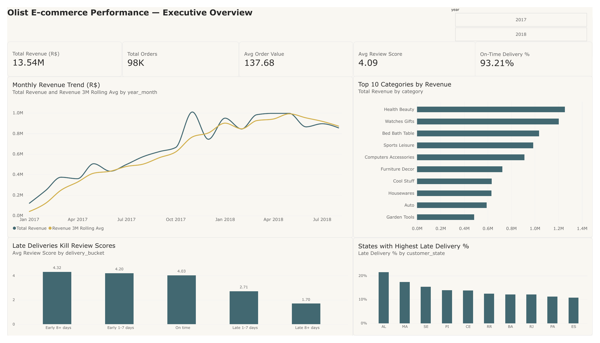
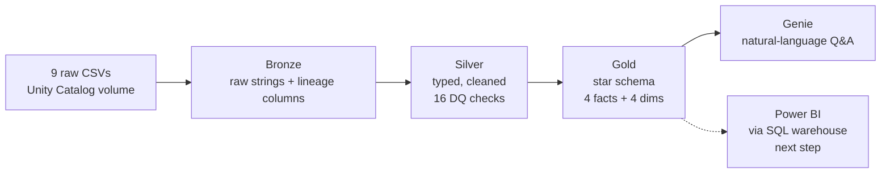
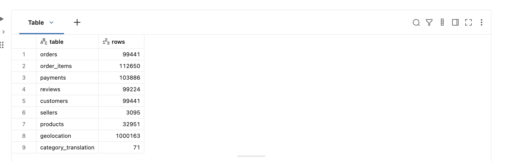
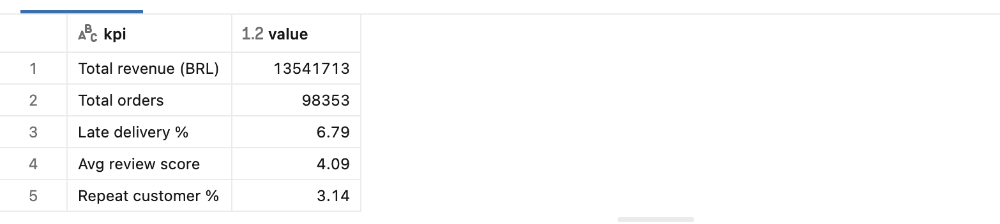
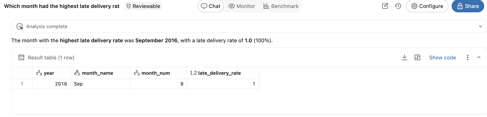
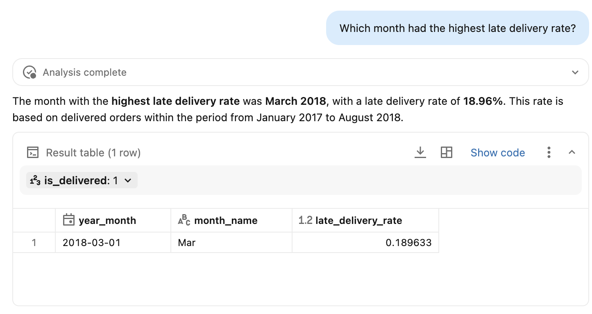
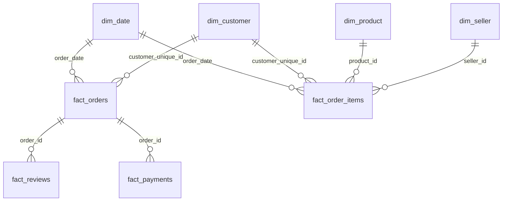
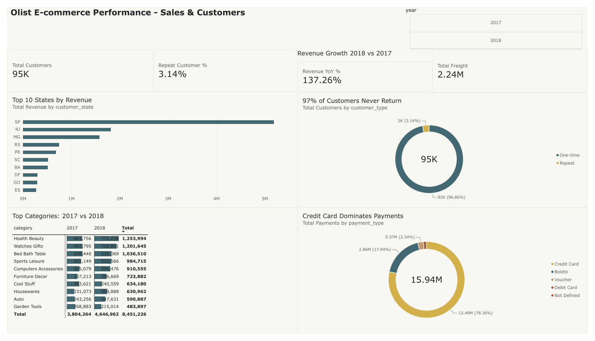
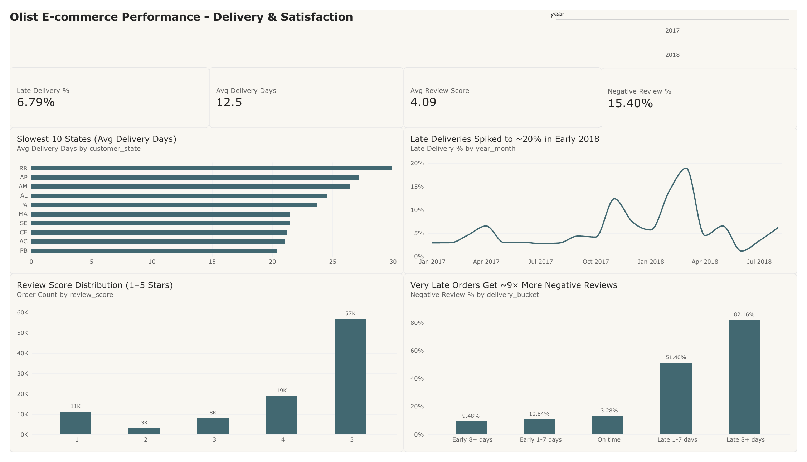

# Olist E-commerce Business Intelligence

An end-to-end BI project on **~100K real e-commerce orders** from Olist, a Brazilian online marketplace, built in two versions:

- **v1 – Python + Power BI:** raw data cleaned in **Python**, modeled as a **star schema** in **Power BI**, analyzed with **20+ DAX measures**, and presented in a **3-page interactive report**.
- **v2 – Databricks:** the same pipeline rebuilt as a **bronze / silver / gold medallion pipeline** in Databricks (Delta tables, Unity Catalog) with **16 automated data-quality checks**. The gold layer **reconciles exactly** with the v1 dashboard, and **Databricks Genie** was evaluated against ground truth: **8/10 → 10/10** after adding business definitions.

**Headline finding:** very late deliveries cut the average review score from **4.32 to 1.70** and make negative reviews **~9× more likely**, and **97% of customers never place a second order**. Fixing logistics in a handful of remote states is the biggest lever for satisfaction and retention.



---

## Business questions

1. How is the business performing, and how fast is it growing?
2. Which products and regions drive revenue?
3. Who are the customers, and do they come back?
4. How reliable is delivery, and where does it break down?
5. What drives customer satisfaction?

## Tech stack

| Layer | Tools |
|---|---|
| Data engineering (v1) | Python (pandas, NumPy), Jupyter |
| Data engineering (v2) | Databricks Free Edition: PySpark notebooks, Delta tables, Unity Catalog, serverless SQL warehouse |
| Data quality (v2) | 16 automated checks logged to a Delta table; pipeline stops on key failures |
| Natural-language analytics (v2) | Databricks AI/BI Genie, evaluated against ground truth |
| Data modeling | Power BI (Power Query, star schema, relationships, date table) |
| Analytics | DAX (time intelligence, ratios, context-aware measures) |
| Visualization | Power BI Desktop: KPI cards, slicers, Top-N filters, matrix with data bars |

---

## v2: Databricks medallion pipeline



### Setup

- **Databricks Free Edition** (serverless compute, one 2X-Small SQL warehouse, non-commercial use).
- Catalog `workspace`, schemas `olist_bronze`, `olist_silver`, `olist_gold`, and a `landing` volume for the raw files.
- Three PySpark notebooks: `01_bronze_ingest`, `02_silver_clean`, `03_gold_star_schema`. They were tested on a local Spark engine before running in Databricks.

### Bronze: land the data as-is

Every column is kept as a string, plus two lineage columns, `_source_file` and `_ingested_at`. Row counts match the source files exactly:

| Table | Rows | Table | Rows |
|---|---|---|---|
| orders | 99,441 | customers | 99,441 |
| order_items | 112,650 | sellers | 3,095 |
| payments | 103,886 | products | 32,951 |
| reviews | 99,224 | geolocation | 1,000,163 |
| category_translation | 71 | | |

<!-- Screenshot: bronze row counts -->


### Silver: type, clean, and test

Silver applies the same fixes as the v1 Python notebook (customer key, delivery metrics, review deduplication, category translation, geolocation cleanup) with proper data types.

**16 data-quality checks** run on every load and are written to `olist_silver.dq_results`. They cover key uniqueness, key relationships between tables, non-negative prices and payments, review scores between 1 and 5, and delivery dates not before purchase dates. **The notebook stops if any key check fails**, so bad data never reaches gold. All 16 checks pass.

### Gold: the star schema, documented

Gold rebuilds the v1 star schema (`fact_orders`, `fact_order_items`, `fact_reviews`, `fact_payments`, `dim_customer`, `dim_product`, `dim_seller`, `dim_date`) with **table and column descriptions** in Unity Catalog, which both people and Genie use to understand the data.

### Reconciliation: gold matches the v1 dashboard exactly

| KPI (Jan 2017 – Aug 2018) | v1 dashboard | Gold layer |
|---|---|---|
| Total revenue (BRL) | 13.54M | 13,541,713 |
| Total orders | 98K | 98,353 |
| Late delivery % | 6.79% | 6.79% |
| Avg review score | 4.09 | 4.09 |
| Repeat customer % | 3.14% | 3.14% |

<!-- Screenshot: gold reconciliation query -->


---

## v2: Evaluating Databricks Genie

Genie answers business questions in plain English by writing SQL. Instead of a demo, it was tested like a model evaluation: **10 questions with known answers**, each designed to catch a specific mistake, graded **correct / partly right / wrong**.

**Setup.** A Genie space on the 8 gold tables, using Chat mode and the serverless SQL warehouse. In round 1 Genie had **no instructions**, only the table and column descriptions from the gold layer. Genie's auto-suggested description and instructions were not accepted.

**Ground truth.** All answers were computed from the same gold tables over all dates, so some differ slightly from the dashboard, which filters Jan 2017 – Aug 2018.

### Results

| # | Question | What it tests | Round 1 | After instructions |
|---|---|---|---|---|
| 1 | What was total revenue in 2017? | Adding freight or using payments | ✅ | ✅ |
| 2 | How many orders were placed in 2018? | Distinct order counting | ✅ | ✅ |
| 3 | What are the top 5 product categories by revenue? | Fact-to-dimension join | ✅ | ✅ |
| 4 | Which customer states have the longest average delivery time? | Join + delivered-only filter | ✅ | ✅ |
| 5 | What percentage of delivered orders arrived late? | Correct denominator | ✅ | ✅ |
| 6 | Average review score for late vs on-time orders? | Grouping by a flag | ✅ | ✅ |
| 7 | What percentage of customers placed more than one order? | Customer-ID trap | ✅ | ✅ |
| 8 | Which month had the highest late delivery rate? | Time grouping | ❌ Sep 2016, 100% | ✅ Mar 2018, 18.96% |
| 9 | What is the average order value? | Price-only vs payments | ❌ R$160.99 | ✅ R$137.75 |
| 10 | Which payment method brings in the most money? | Simple aggregation | ✅ | ✅ |
| | **Score** | | **8/10 (80%)** | **10/10 (100%)** |

Full answers, ground truth and notes are in [`genie/genie_evaluation.xlsx`](genie/genie_evaluation.xlsx).

### What went wrong, and why

Genie got the **technical** parts right without help: joins, the delivered-only filter, distinct counts, and even the `customer_unique_id` trap. Both misses were about **business definitions**:

- **Q8, the sparse-month trap.** September 2016 has only a handful of orders, so one late order gives a 100% late rate. The SQL was valid, but the answer is useless for the business. This is the same problem that led to the Jan 2017 – Aug 2018 window in the v1 dashboard.
- **Q9, the definition trap.** Genie computed average order value from payments, which include freight and instalment interest. When re-run in a fresh chat it picked a *different* wrong definition (price + freight, R$160.58). **Without a written definition, Genie was not even consistent with itself.**

<!-- Screenshots: Q8 before and after -->
| Before instructions | After instructions |
|---|---|
|  |  |

### Round 2: business instructions

Plain-English definitions were added to the Genie space. They are general business rules, not answers to the test questions; the month-window rule is the same one used in the v1 dashboard.

<details>
<summary>Instructions given to Genie</summary>

```
Business definitions for the Olist marketplace (currency: BRL)

Revenue
- Revenue = SUM(fact_order_items.price). It excludes freight.
- Do not use fact_payments for revenue. Payments include freight and instalment interest. Use fact_payments only for questions about payments or payment methods.

Orders and order value
- Orders = COUNT(DISTINCT order_id).
- Average order value (AOV) = SUM(fact_order_items.price) / COUNT(DISTINCT fact_order_items.order_id). Price only: no freight, no payments.

Customers
- A customer is customer_unique_id, never customer_id (Olist creates a new customer_id for every order).
- Repeat customer = a customer_unique_id with more than one distinct order.

Delivery
- Late delivery % and average delivery time use delivered orders only (is_delivered = 1).
- On-time orders = delivered orders that were not late (this includes early deliveries). Do not use only delivery_bucket = 'On time' for this; that bucket means delivered exactly on the promised date.

Reviews
- Negative review = review score of 1 or 2 stars.

Dates and time periods
- Join facts to dim_date on order_date = dim_date.date.
- For month-level analysis (trends, best or worst month, monthly rates), use only January 2017 to August 2018. Months before and after this window have very few orders and give misleading rates.
```

</details>

**Regression check.** After adding the instructions, all 10 questions were asked again to make sure nothing that was already correct broke. In one run (several questions asked in the same chat) Q6 reported on-time reviews as 4.03, using only the narrow "delivered exactly on the promised day" bucket. Re-run in a fresh chat it gave the correct 4.29, both before and after an explicit on-time definition was added. Final result: **10/10, with no reproducible regressions.**

### Lessons

1. **Good metadata gets you far.** With only table and column descriptions, Genie scored 8/10 and handled the classic Olist customer-ID trap on its own.
2. **Definitions, not SQL, are the gap.** Every miss was a business-definition question: which months count, and what "order value" means.
3. **Instructions fix this cheaply,** but they must be general rules, and every change needs a regression check.
4. **Test in fresh chats.** Earlier questions in the same chat can change later answers.

### Limitations

- One run per question (two for the misses), so this measures typical behaviour, not a statistical accuracy rate. Genie's answers can vary between runs.
- 10 questions is a small test set, designed to probe specific known traps.

---

## v1: Python pipeline and Power BI report

### 1. Data pipeline (Python)

Source: the [Brazilian E-Commerce Public Dataset by Olist](https://www.kaggle.com/datasets/olistbr/brazilian-ecommerce) on Kaggle, which has 9 relational tables covering orders, items, payments, reviews, customers, sellers, products, geolocation, and category translations.

The notebook [`notebooks/olist_data_cleaning.ipynb`](notebooks/olist_data_cleaning.ipynb) turns the raw tables into a Power BI-ready star schema. Key steps:

- **Fixed the customer key.** In Olist, `customer_id` is a new ID for *every order*, so without this fix almost every customer looks like a first-time buyer. The pipeline uses the true `customer_unique_id` as the customer key, which is what makes the repeat-customer analysis possible.
- **Engineered delivery metrics:** delivery days, delay vs. promised date, a late flag, and delay buckets (Early 8+ days → Late 8+ days).
- **Deduplicated reviews** and attached the latest review score to each order.
- **Translated** Portuguese product categories to English.
- **Cleaned geolocation:** removed coordinates outside Brazil and averaged to one point per zip prefix.
- **Built a full-year date table** (2016–2018) so DAX time intelligence works correctly.

### 2. Data model (star schema)



| Table | Grain | Rows |
|---|---|---|
| `fact_orders` | One row per order (delivery + review metrics) | 99,441 |
| `fact_order_items` | One row per item sold (sales metrics) | 112,650 |
| `fact_reviews` | One row per review | 99,224 |
| `fact_payments` | One row per payment | 103,886 |
| `dim_customer` | One row per real customer | 96,096 |
| `dim_product` | One row per product | 32,951 |
| `dim_seller` | One row per seller | 3,095 |
| `dim_date` | One row per day (2016–2018) | 1,096 |

**Design decisions:**
- All relationships are **one-to-many with single-direction filtering**, which avoids ambiguous filter paths.
- `fact_orders` and `fact_order_items` deliberately have **no direct relationship**. They connect only through shared dimensions, so filters behave predictably.
- All measures live in a dedicated **`_Measures` table**.

### 3. DAX highlights

All measures are in [`dax/measures.dax`](dax/measures.dax). The Power BI file itself is available under [Releases](https://github.com/rsavinash25-maker/olist-ecommerce-bi/releases/latest). A few worth noting:

**Honest year-over-year growth.** A naive YoY measure showed +328% with no year selected, because it compared all data against a mostly empty 2016. This version only returns a value when exactly one year is in context:

```dax
Revenue YoY % =
VAR _yoy = DIVIDE([Total Revenue] - [Revenue PY], [Revenue PY])
RETURN IF(HASONEVALUE(dim_date[year]), _yoy)
```

**3-month rolling average** to smooth monthly noise:

```dax
Revenue 3M Rolling Avg =
VAR _period = DATESINPERIOD(dim_date[date], MAX(dim_date[date]), -3, MONTH)
RETURN DIVIDE(CALCULATE([Total Revenue], _period), 3)
```

**Grain-aware counting.** Sales measures count from `fact_order_items` so they slice correctly by product and seller, while delivery and review measures use `fact_orders`.

### 4. Report pages

The analysis window is **Jan 2017 – Aug 2018**. The sparse first and last months are filtered out so trends don't show artificial drops. A synced **year slicer** works across all pages.

#### Executive Overview
Revenue, orders, average order value, review score, on-time delivery, the monthly revenue trend, top categories, and the delivery-vs-review relationship (shown at the top of this README).

#### Sales & Customers


#### Delivery & Satisfaction


A full PDF export of all three pages is in [`reports/Olist_BI_Dashboard.pdf`](reports/Olist_BI_Dashboard.pdf), and the `.pbix` file can be downloaded from [Release v1.0](https://github.com/rsavinash25-maker/olist-ecommerce-bi/releases/latest).

---

## Key insights

**Growth**
- **R$13.54M** in product revenue from **98K orders** (average order value R$137.68).
- Revenue grew **+137%** in Jan–Aug 2018 vs. Jan–Aug 2017, reaching about **R$1M per month**, with a visible **Black Friday spike in Nov 2017**.
- **Health & Beauty** (R$1.25M) and **Watches & Gifts** (R$1.20M) are the top categories.
- **São Paulo (SP)** generates by far the most revenue, nearly 3× the next state (RJ).
- **Credit card** accounts for **78%** of payment value, followed by **boleto** (Brazilian bank slip) at **18%**.

**Delivery & satisfaction**
- **93% of orders arrive on time**, but the late 7% do outsized damage:

| Delivery | Avg review | Negative reviews (1–2★) |
|---|---|---|
| Early 8+ days | 4.32 | 9.5% |
| On time | 4.03 | 13.3% |
| Late 1–7 days | 2.71 | 51.4% |
| Late 8+ days | **1.70** | **82.2%** |

- Late deliveries **spiked to ~20% in early 2018**, following the late-2017 peak season.
- Remote northern states (**RR, AP, AM**) average **25–30 days** to deliver, more than double the **12.5-day** average.
- Reviews are **polarized**: there are as many 1-star reviews (11K) as 2-star and 3-star reviews combined (3K + 8K).

**Retention**
- **96.9% of customers buy only once.** The repeat rate is just **3.1%**.

## Recommendations

1. **Prioritize delivery reliability over speed.** Being early adds little satisfaction (4.32 vs. 4.03), but being late destroys it (down to 1.70).
2. **Fix logistics for northern states**, through regional carriers, distribution points, or more realistic promised dates.
3. **Plan capacity ahead of peak seasons** to avoid repeating the early-2018 late-delivery spike.
4. **Launch retention programs** (post-purchase follow-up, loyalty incentives), because with a 3% repeat rate even small gains matter.
5. **Proactively contact customers on late orders**, since an apology or voucher may prevent a 1-star review.

---

## Repository structure

```
├── README.md
├── notebooks/
│   └── olist_data_cleaning.ipynb    # v1 Python pipeline: raw CSVs → star schema
├── genie/
│   └── genie_evaluation.xlsx        # Genie test set, answers, grades, method
├── dax/
│   └── measures.dax                 # All DAX measures
├── reports/
│   └── Olist_BI_Dashboard.pdf       # PDF export of all pages
└── images/                          # Report screenshots
    └── v2/                          # Databricks and Genie screenshots
```

## How to reproduce

**v1 (Python + Power BI)**
1. Download the dataset from [Kaggle](https://www.kaggle.com/datasets/olistbr/brazilian-ecommerce) and place the 9 CSVs in a folder named `olist_raw` next to the notebook.
2. Run `notebooks/olist_data_cleaning.ipynb`. It writes 8 cleaned CSVs to `olist_clean/`.
3. Download `Olist_BI_Platform.pbix` from [Release v1.0](https://github.com/rsavinash25-maker/olist-ecommerce-bi/releases/latest) and open it in Power BI Desktop (Windows). If prompted, point the data source to your `olist_clean` folder (**Transform data → Data source settings**) and refresh.

**v2 (Databricks)**
1. Create a free [Databricks Free Edition](https://www.databricks.com/learn/free-edition) account.
2. Create the schemas `olist_bronze`, `olist_silver`, `olist_gold` in the `workspace` catalog, and a volume `landing` in `olist_bronze`.
3. Upload the 9 raw CSVs to the volume.
4. Run the three notebooks in order (bronze → silver → gold). The silver step stops if a key data-quality check fails.
5. Optional: create a Genie space on the 8 `olist_gold` tables and ask the questions in `genie/genie_evaluation.xlsx`.

The data files aren't included in this repo because of their size. The notebooks regenerate them.

## Roadmap

- [x] Rebuild the pipeline as bronze / silver / gold layers (Databricks)
- [x] Automated data-quality checks and reconciliation against the dashboard
- [x] Evaluate Databricks Genie against ground truth
- [ ] Connect Power BI Desktop to the gold tables through the SQL warehouse and confirm the report numbers match
- [ ] RFM customer segmentation and cohort retention analysis
- [ ] Sentiment analysis on review text
- [ ] Sales forecasting
- [ ] Row-level security by seller region

## Data source & license

Data: [Olist Brazilian E-Commerce Public Dataset](https://www.kaggle.com/datasets/olistbr/brazilian-ecommerce), licensed by Olist under CC BY-NC-SA 4.0. Used here for non-commercial, educational purposes.

---

**Author:** Avinash Rajasekar
